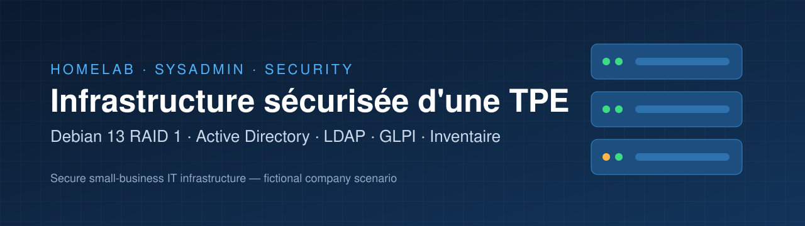
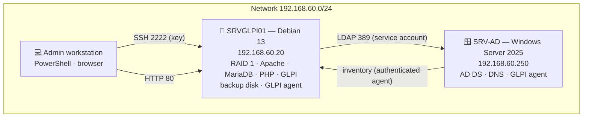
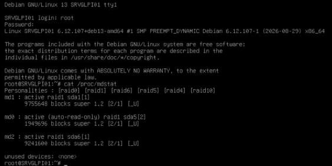
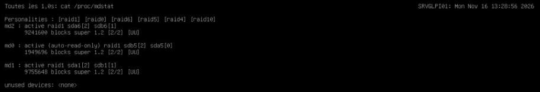
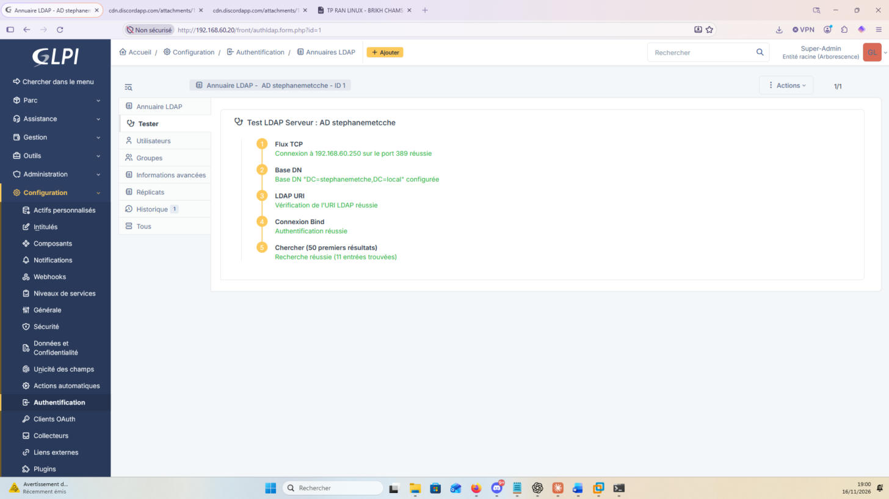
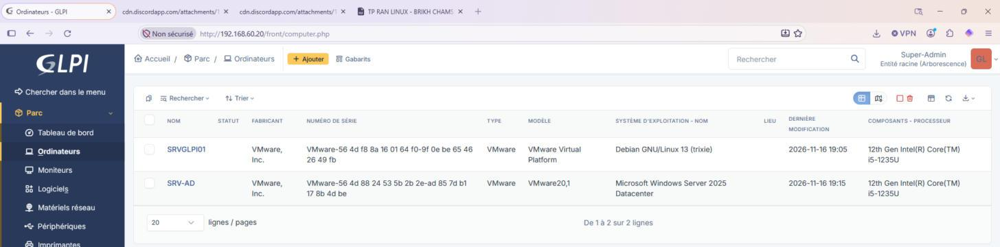
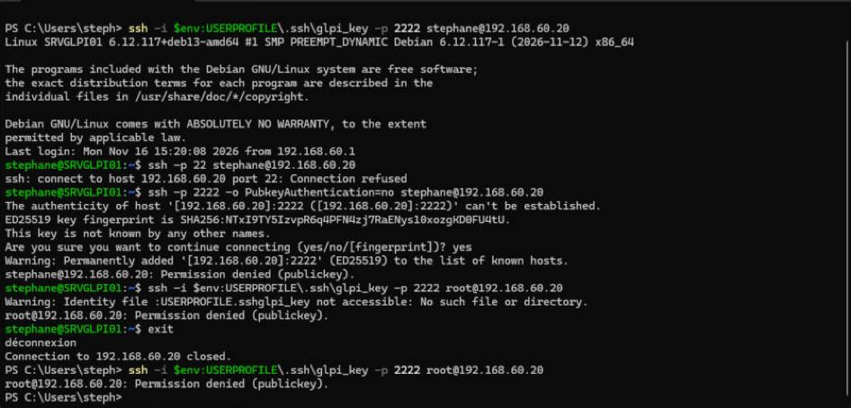
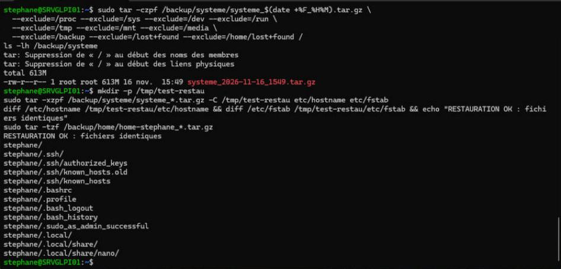

  

  <a href="README.md">🇫🇷 Français</a> · 🇬🇧 <b>English</b>

  
  
  
  
  
  
  
  

---

## 🎓 Context

> 📚 **Training project** — Hands-on lab completed at school, as part of the French professional certification **Secure Infrastructure Administrator (AIS)** at **GRETA**.
> Everything was deployed in a **virtual lab** (VMware Workstation): this is not a real customer engagement.

## 🏢 The scenario

> **Menuiserie Valloire** is a **fictional company** created to give the lab a realistic setting: a 20-person joinery business near Tours (France), with a workshop, a design office and an admin team.

Its IT grew without a plan: separate accounts everywhere, no hardware inventory, data on a single disk and no tested backup.

**My mission:** build a solid, secure and maintainable foundation:

| Business need | What I delivered |
|---|---|
| Don't lose data when a disk fails | Debian server on **software RAID 1**, disk failure tested for real |
| Recover from mistakes | **Backups** on a dedicated disk + **tested restore** |
| One account per employee | **Active Directory** connected to GLPI over **LDAP** |
| Know what's in the fleet | **Automatic inventory** of servers and workstations (GLPI agents) |
| Track requests and incidents | **GLPI**, open-source ITSM |
| Reduce the attack surface | **Key-only SSH**, **UFW** firewall, least privilege everywhere |

---

## 🗺️ Architecture

---

## 🧰 Skills demonstrated

| Area | What I implemented |
|---|---|
| **Storage** | Manual MBR partitioning, `mdadm` RAID 1 (3 mirrors), GRUB on both disks, **failure simulation and rebuild** |
| **Linux** | Static IP, DNS, security repositories and updates, `sudo` user, UUID-based mounts |
| **Security** | ed25519 key-only SSH, root login disabled, custom port, allow-list; UFW "deny all except"; default accounts neutralised |
| **Backup** | Timestamped `tar` archives, controlled exclusions, **restore test**, 3-2-1-1-0 analysis |
| **Web / DB** | LAMP stack, dedicated least-privilege database user, Apache VirtualHost exposing `public/` only |
| **Windows Server** | AD DS, DNS (reverse zone), users and service account via PowerShell, **GPO** |
| **Directory** | GLPI ↔ AD LDAP integration, `ldapsearch` testing, user import and authentication |
| **Asset management** | GLPI agents on Linux (Perl installer) and Windows (silent MSI), agent authentication |
| **Method** | Troubleshooting from simple to complex, test-before-apply, documented limitations |

---

## 📸 Screenshots

<table>
  <tr>
    <td width="50%"> <b>Simulated failure</b>: one disk removed, the server keeps running in degraded mode <code>[_U]</code>.</td>
    <td width="50%"> <b>Rebuild</b>: disk re-added, all three mirrors back to <code>[UU]</code>.</td>
  </tr>
  <tr>
    <td> <b>LDAP integration</b>: all five GLPI checks green.</td>
    <td> <b>Automatic inventory</b>: Debian and Windows Server reported by their agents.</td>
  </tr>
  <tr>
    <td> <b>Hardened SSH</b>: key accepted; port 22, password and root rejected.</td>
    <td> <b>Verified backup</b>: restored files identical to the originals.</td>
  </tr>
</table>

*(Screenshots are from a French-language environment.)*

---

## 💽 Case study: the silent degraded RAID

Right after installation, the server ran perfectly… while one of its mirrors had **only one disk**, with no alert at all. Detection, fix, then a **real disk-failure simulation** and rebuild: the full RAID 1 lifecycle, with screenshots.

➡️ **[Read the full case study (in French)](docs/raid-degrade.md)**

---

## 🔧 Troubleshooting highlights

The most valuable part of this project was the problems I ran into. Each one is documented as **Symptom → Diagnosis → Root cause → Fix**.

| Incident | Root cause | Fix |
|---|---|---|
| RAID degraded `[U_]` **with no alert** right after install | One partition was never added to its mirror | Spotted in `/proc/mdstat`, `mdadm --add` |
| Disk reconnected but **not re-added** | Linux refuses a member that missed writes | Deliberate re-add, monitored rebuild |
| **No DNS resolution** after switching to static IP | The DHCP client emptied `resolv.conf` on shutdown | DNS servers set manually |
| `sdb` **became `sdc`** after adding a disk | Names follow detection order | **UUID** mounts, double-check before formatting |
| LDAP: `Strong(er) authentication required` | Windows Server 2025 requires LDAP signing by default | GPO adjusted for the lab, **LDAPS** planned |
| GLPI agent: `403` then `authentication required` | Inventory not saved, then agent auth required | Enabled + dedicated agent credentials |

➡️ Full write-ups (in French): [docs/incidents.md](docs/incidents.md)

---

## 🛡️ Security choices and known limitations

- **Plain LDAP (389)**: acceptable on an isolated lab network. **Production → LDAPS (636)** with AD CS, then re-enforce LDAP signing.
- **Backup on the same machine**: protects against mistakes, not disasters. **Next:** off-site copy, offline copy (ransomware), scheduling, encryption.
- **HTTP without TLS** for GLPI: switch to **HTTPS** before going live.

➡️ Details (in French): [docs/securite.md](docs/securite.md)

## 🚀 Roadmap

- [ ] LDAPS with AD CS and GPO certificate auto-enrolment
- [ ] HTTPS for GLPI
- [ ] Automated, off-site, encrypted backups
- [ ] Commented, idempotent GLPI install script
- [ ] Automated Debian install (preseed + PXE)
- [ ] Monitoring (Zabbix) and centralised logging

---

  <b>Stéphane Metche</b> · Secure infrastructure administrator in training · aiming for DevSecOps 
  <a href="https://mr-metche.com">mr-metche.com</a> · <a href="https://github.com/stephanemetche">GitHub</a>

School lab (AIS training, GRETA) built in a virtual environment. “Menuiserie Valloire” is a fictional company.

