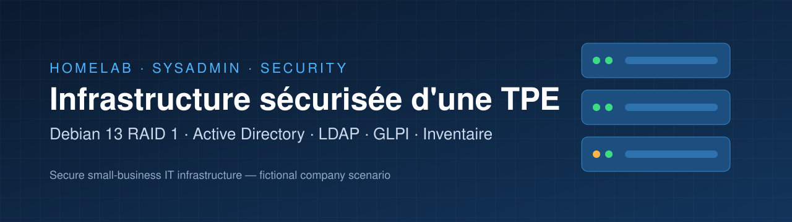
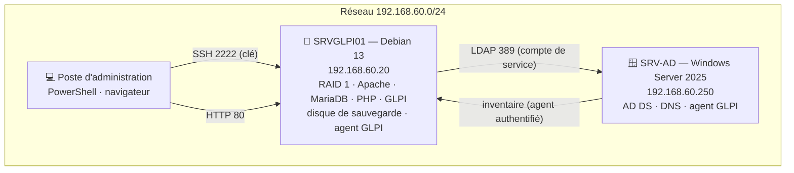
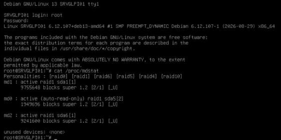
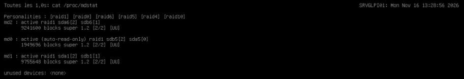
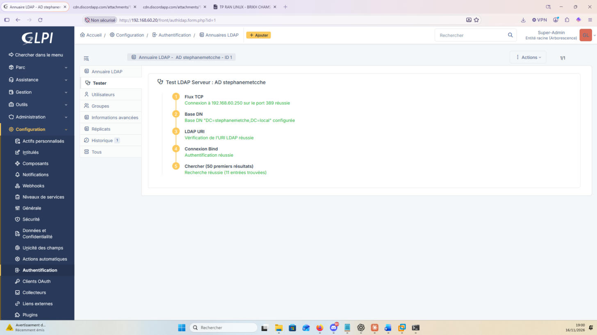
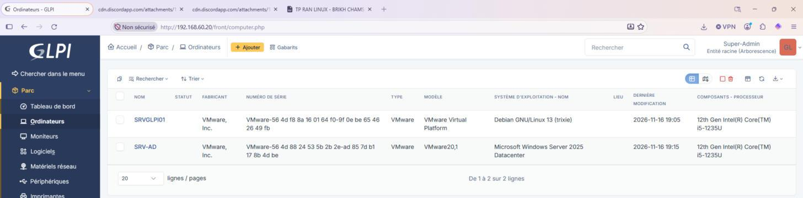
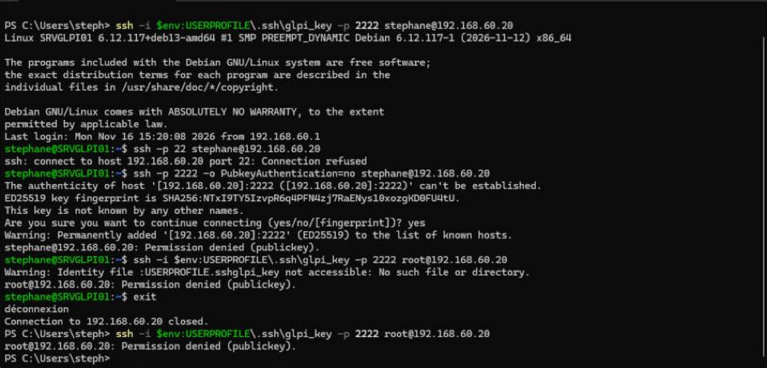
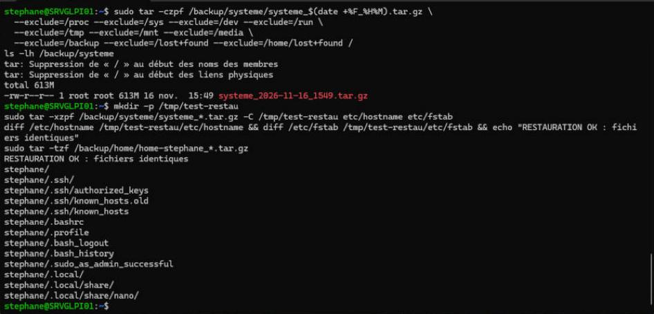

<p align="center">
  
</p>

<p align="center">
  🇫🇷 <b>Français</b> · <a href="README.en.md">🇬🇧 English</a>
</p>

<p align="center">
  
  
  
  
  
  
  
  
</p>

---

## 🎓 Contexte

> 📚 **Projet de formation** — Travail pratique réalisé en école, dans le cadre du **titre professionnel Administrateur d'Infrastructures Sécurisées (AIS)** au **GRETA**.
> Tout a été déployé dans un **laboratoire virtuel** (VMware Workstation) : il ne s'agit pas d'une intervention chez un client réel.

## 🏢 Le scénario

> **Menuiserie Valloire** est une **entreprise fictive** imaginée pour donner un cadre concret au TP : une TPE de 20 personnes, près de Tours, avec un atelier, un bureau d'études et un service administratif.

Son informatique s'est construite au fil de l'eau : des comptes différents partout, aucun inventaire des postes, des données sur un seul disque et aucune sauvegarde testée.

**Ma mission :** poser une base solide, sécurisée et maintenable :

| Besoin de l'entreprise | Réponse apportée |
|---|---|
| Ne plus perdre de données si un disque lâche | Serveur Debian en **RAID 1 logiciel**, panne testée en conditions réelles |
| Pouvoir revenir en arrière après une erreur | **Sauvegardes** sur disque dédié + **restauration testée** |
| Un seul compte par salarié | **Active Directory** relié à GLPI par **LDAP** |
| Savoir ce que contient le parc | **Inventaire automatique** des serveurs et postes (agents GLPI) |
| Suivre les demandes et incidents | **GLPI**, outil ITSM open source |
| Limiter la surface d'attaque | **SSH par clé**, pare-feu **UFW**, moindre privilège partout |

---

## 🗺️ Architecture



Détails : [docs/architecture.md](docs/architecture.md)

---

## 🧰 Compétences démontrées

| Domaine | Ce que j'ai mis en œuvre |
|---|---|
| **Stockage** | Partitionnement manuel MBR, RAID 1 `mdadm` (3 miroirs), GRUB sur les deux disques, **simulation de panne et reconstruction** |
| **Système Linux** | IP fixe, DNS, dépôts et mises à jour de sécurité, utilisateur `sudo`, montage par UUID |
| **Sécurité** | SSH par clé ed25519, root interdit, port dédié, liste blanche ; UFW en « tout refuser sauf » ; comptes par défaut neutralisés |
| **Sauvegarde** | Archives `tar` horodatées, exclusions maîtrisées, **test de restauration**, analyse 3-2-1-1-0 |
| **Web / BDD** | Pile LAMP, base dédiée en moindre privilège, VirtualHost Apache exposant uniquement `public/` |
| **Windows Server** | AD DS, DNS (zone inversée), comptes et compte de service en PowerShell, **GPO** |
| **Annuaire** | Liaison LDAP GLPI ↔ AD, tests `ldapsearch`, import et authentification des utilisateurs |
| **Supervision du parc** | Agents GLPI Linux (installeur Perl) et Windows (MSI silencieux), authentification des agents |
| **Méthode** | Diagnostic du plus simple au plus complexe, tests avant application, documentation des limites |

---

## 📸 En images

<table>
  <tr>
    <td width="50%"><br><sub><b>Panne simulée</b> : un disque retiré, le serveur tourne en mode dégradé <code>[_U]</code>.</sub></td>
    <td width="50%"><br><sub><b>Reconstruction</b> : disque réintégré, les trois miroirs reviennent en <code>[UU]</code>.</sub></td>
  </tr>
  <tr>
    <td><br><sub><b>Liaison LDAP</b> : les cinq contrôles de GLPI au vert.</sub></td>
    <td><br><sub><b>Inventaire automatique</b> : Debian et Windows Server remontés par leurs agents.</sub></td>
  </tr>
  <tr>
    <td><br><sub><b>SSH durci</b> : clé acceptée ; port 22, mot de passe et root refusés.</sub></td>
    <td><br><sub><b>Sauvegarde vérifiée</b> : fichiers restaurés identiques aux originaux.</sub></td>
  </tr>
</table>

---

## 💽 Étude de cas : le RAID dégradé silencieux

Juste après l'installation, le serveur fonctionnait parfaitement… alors qu'un de ses miroirs n'avait **qu'un seul disque**, sans aucune alerte. Détection, correction, puis **simulation d'une vraie panne de disque** et reconstruction : tout le cycle de vie du RAID 1, captures à l'appui.

➡️ **[Lire l'étude de cas complète](docs/raid-degrade.md)**

---

## 🔧 Incidents résolus (extrait)

Le plus formateur dans ce projet, ce sont les problèmes rencontrés. Chacun est documenté au format **Symptôme → Diagnostic → Cause → Solution**.

| Incident | Cause | Solution |
|---|---|---|
| RAID dégradé `[U_]` **sans aucune alerte** après l'installation | Une partition jamais ajoutée au miroir | Détection via `/proc/mdstat`, `mdadm --add` |
| Disque remis en place mais **non réintégré** | Linux refuse un membre qui a manqué des écritures | Réintégration volontaire, reconstruction suivie |
| Plus de **résolution DNS** après passage en IP fixe | Le client DHCP a vidé `resolv.conf` en s'arrêtant | DNS déclarés manuellement |
| Le disque `sdb` **devient `sdc`** après l'ajout d'un disque | Noms attribués dans l'ordre de détection | Montage par **UUID**, double vérification avant formatage |
| LDAP : `Strong(er) authentication required` | Windows Server 2025 exige la signature LDAP par défaut | GPO adaptée pour le lab, **LDAPS** prévu |
| Agent GLPI : `403` puis `authentication required` | Inventaire non sauvegardé, puis authentification des agents exigée | Activation + identifiants dédiés à l'agent |

➡️ Tous les incidents : [docs/incidents.md](docs/incidents.md)

---

## 🛡️ Choix de sécurité et limites assumées

Une solution n'est sérieuse que si l'on connaît ses limites :

- **LDAP non chiffré (389)** : acceptable sur un réseau de lab isolé. **En production → LDAPS (636)** avec une autorité de certification (AD CS), puis rétablissement de la signature LDAP.
- **Sauvegarde sur la même machine** : protège d'une erreur, pas d'un sinistre. **À ajouter :** copie hors site, copie hors ligne (anti-rançongiciel), planification et chiffrement.
- **HTTP sans TLS** pour GLPI : à passer en **HTTPS** avant toute mise en service.

➡️ Le détail : [docs/securite.md](docs/securite.md)

---

## 📁 Contenu du dépôt

```
├── README.md / README.en.md     Présentation (FR / EN)
├── docs/
│   ├── architecture.md          Machines, réseau, flux, plan de partitionnement
│   ├── procedure.md             Procédure complète, étape par étape, avec vérifications
│   ├── raid-degrade.md          Étude de cas : RAID dégradé, panne et reconstruction
│   ├── incidents.md             Incidents rencontrés et résolus
│   └── securite.md              Choix de sécurité, compromis, améliorations
├── configs/                     Fichiers de configuration commentés
└── assets/                      Bannière et captures
```

## 🚀 Pistes d'évolution

- [ ] LDAPS avec AD CS et auto-enrôlement des certificats par GPO
- [ ] HTTPS sur GLPI (certificat interne)
- [ ] Sauvegardes automatisées, externalisées et chiffrées (cron/systemd + rsync/borg)
- [ ] Script d'installation de GLPI commenté et idempotent
- [ ] Installation Debian automatisée (preseed + PXE)
- [ ] Supervision (Zabbix) et centralisation des journaux

---

<p align="center">
  <b>Stéphane Metche</b> · Administrateur d'infrastructures sécurisées en formation · objectif DevSecOps<br>
  <a href="https://mr-metche.com">mr-metche.com</a> · <a href="https://github.com/stephanemetche">GitHub</a>
</p>
<p align="center"><sub>TP réalisé en école (formation AIS, GRETA) dans un laboratoire virtuel. « Menuiserie Valloire » est une entreprise fictive.</sub></p>
