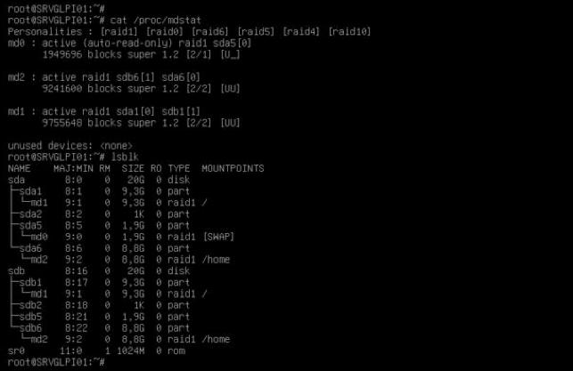
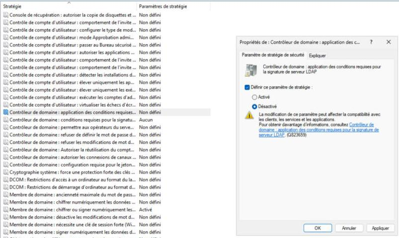

# 🔧 Incidents rencontrés et résolus

> Format : **Symptôme → Diagnostic → Cause → Solution → Ce que j'en retiens**

---

## 1. Une partition installée hors du miroir

- **Symptôme :** dans le partitionnement, une partition logique de 2 Go affichait `f ext4 /` au lieu de `K raid`.
- **Diagnostic :** lecture des indicateurs de l'installateur (`f` = sera formatée, `K` = conservée, `B` = amorçable).
- **Cause :** le type « volume physique pour RAID » n'avait pas été validé ; l'installateur avait gardé son choix par défaut.
- **Solution :** type corrigé avant d'écrire les changements sur les disques.
- **À retenir :** relire le récapitulatif avant de valider ; une erreur ici aurait placé le système hors du RAID.

## 2. RAID dégradé sans aucune alerte

- **Symptôme :** le serveur démarrait normalement.
- **Diagnostic :** `cat /proc/mdstat` → `md0 : … [2/1] [U_]` ; `lsblk` → `sdb5` rattachée à aucun miroir.
- **Cause :** une partition jamais ajoutée au miroir lors de sa création.
- **Solution :** `mdadm --manage /dev/md0 --add /dev/sdb5` → `[UU]`.
- **À retenir :** un RAID se **surveille**. Il peut fonctionner dégradé sans aucun message. ➡️ [Étude de cas complète](raid-degrade.md)

## 3. Disque remis en place mais non réintégré

- **Symptôme :** après la simulation de panne, disque rebranché, mais `md1` et `md2` toujours en `[_U]`.
- **Diagnostic :** `lsblk` → les partitions du disque rebranché ne sont rattachées à aucun `md`.
- **Cause :** comportement de sécurité de Linux : le disque a manqué des écritures, ses données sont périmées. Il attend la décision de l'administrateur. (Le swap, resté en lecture seule pendant la panne, s'est réassemblé seul.)
- **Solution :** `mdadm --add` sur chaque miroir, reconstruction suivie avec `watch -n1 cat /proc/mdstat`.
- **À retenir :** GRUB doit aussi être installé sur le second disque (`grub-install /dev/sdb`), sinon le serveur ne redémarre pas sans le premier.

## 4. Mauvais fichier disque après un instantané

- **Symptôme :** quatre fichiers `.vmdk` au lieu de deux au moment de rebrancher le disque.
- **Cause :** l'instantané gèle le disque parent et écrit les changements dans un fichier « delta » (`…-000001.vmdk`).
- **Solution :** rebrancher le **delta**, pas le parent (sinon l'instantané est corrompu).

## 5. Dépôt de sécurité désactivé

- **Symptôme :** pendant l'installation, `security.debian.org` inaccessible.
- **Diagnostic :** réseau VMware vérifié (passerelle, DHCP, DNS corrects), puis `ping` réussi après l'installation : coupure ponctuelle.
- **Cause :** l'installateur a commenté les lignes `security` dans `/etc/apt/sources.list`.
- **Solution :** sauvegarde du fichier, réactivation ciblée avec `sed`, `apt update && apt full-upgrade`.
- **À retenir :** sans ce dépôt, aucun correctif de sécurité n'arrive.

## 6. `sudo : commande introuvable`

- **Cause :** quand un mot de passe root est défini à l'installation, Debian n'installe pas `sudo`.
- **Solution :** `apt install sudo`, `usermod -aG sudo <user>`, puis **reconnexion** (les groupes sont lus à l'ouverture de session).

## 7. Plus de résolution DNS après le passage en IP fixe

- **Symptôme :** `ping 1.1.1.1` OK, mais `ping deb.debian.org` → « Échec temporaire dans la résolution du nom ».
- **Diagnostic :** `/etc/resolv.conf` contenait seulement « Generated by dhcpcd », sans aucun `nameserver`.
- **Cause :** le client DHCP a retiré les DNS qu'il avait fournis en s'arrêtant.
- **Solution :** DNS déclarés manuellement ; dhcpcd ne tourne plus, il ne réécrira pas le fichier.
- **Méthode utilisée :** IP → passerelle → sortie Internet → DNS, du plus proche au plus lointain.

## 8. Les noms de disques changent

- **Symptôme :** après l'ajout du disque de sauvegarde, celui-ci s'appelait `sdb` et l'ancien `sdb` du RAID était devenu `sdc`.
- **Cause :** les noms `sdX` suivent l'ordre de détection au démarrage.
- **Solution :** vérification avec `/proc/mdstat` avant de formater (une erreur aurait détruit une moitié du miroir), puis montage par **UUID** dans `/etc/fstab`.

## 9. Configuration réseau héritée sur le contrôleur de domaine

- **Symptôme :** le DC n'avait pas accès à Internet.
- **Diagnostic :** `ipconfig /all` → passerelle `.254` inexistante ; `Get-DhcpServerv4Scope` → une étendue DHCP Windows **active** sur le même réseau que le DHCP de VMware, incluant l'IP fixe du serveur GLPI.
- **Solution :** route par défaut corrigée, étendue mise en pause (réversible), redirecteur DNS ajouté.
- **À retenir :** un seul serveur DHCP par réseau ; contrôler l'existant avant de construire dessus.

## 10. LDAP refusé par Windows Server 2025

- **Diagnostic progressif avec `ldapsearch` :**
  1. `Invalid credentials (49) … data 52e` → mauvais mot de passe du compte de service (réinitialisé).
  2. `Strong(er) authentication required (8)` → le DC exige des liaisons signées.
- **Cause :** durcissement par défaut de Windows Server 2025 (signature LDAP et sa mise en application).
- **Solution (lab) :** GPO *Default Domain Controllers Policy* adaptée, `gpupdate /force` → `result: 0 Success`, puis 5 coches vertes dans GLPI.
- **Solution cible :** LDAPS avec AD CS (voir [securite.md](securite.md)).

## 11. Administrateur GLPI bloqué à la connexion

- **Symptôme :** « Identifiant ou mot de passe incorrect » pour le compte local `glpi`.
- **Cause :** l'annuaire AD est déclaré serveur par défaut ; la page de connexion cherchait donc le compte `glpi` dans l'AD.
- **Solution :** choisir la source « Base interne GLPI » pour ce compte. (Réinitialisation de l'empreinte du mot de passe en base au passage, avec `password_hash`.)

## 12. L'agent d'inventaire refusé

- **Diagnostic dans les journaux de l'agent :**
  1. `403 Forbidden` → inventaire basculé mais **non sauvegardé** dans GLPI.
  2. `authentication required, no credentials available` → GLPI 12 exige l'authentification des agents.
- **Solution :** inventaire activé et sauvegardé ; identifiants dédiés aux agents, fournis à l'agent Linux (fichier en `600`) et à l'agent Windows (paramètres MSI).
- **À retenir :** l'authentification évite qu'une machine inconnue injecte de fausses fiches dans le parc. Je l'ai conservée.
