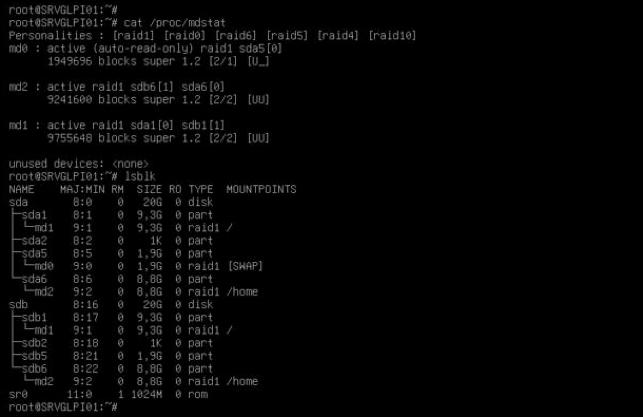
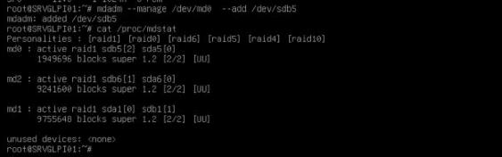
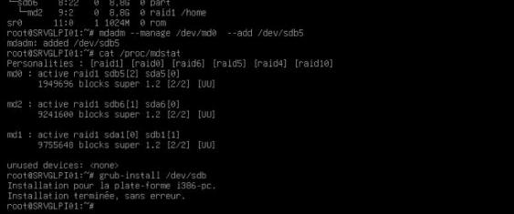
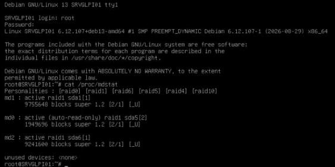
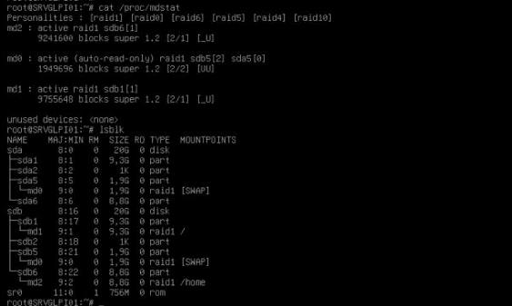
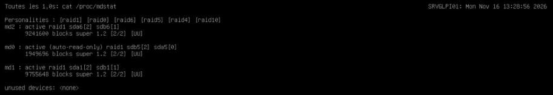

# 💽 Étude de cas — Le RAID dégradé silencieux

> TP réalisé en école (formation AIS, GRETA), en laboratoire virtuel. Contexte fictif : serveur de la Menuiserie Valloire.

**En une phrase :** juste après l'installation, le serveur fonctionnait parfaitement… alors qu'un de ses miroirs n'avait **qu'un seul disque**. Aucun message ne le signalait. Je l'ai détecté, corrigé, puis j'ai simulé une vraie panne de disque pour vérifier que l'ensemble tenait.

---

## 1. Rappel : à quoi sert un RAID 1 ?

Le **RAID 1**, c'est le **miroir** : deux disques contiennent exactement les mêmes données, écrites en même temps.

```
          écriture d'un fichier
                  │
           ┌──────┴──────┐
           ▼             ▼
       ┌───────┐     ┌───────┐
       │ sda   │  =  │ sdb   │     ← copie identique, en permanence
       └───────┘     └───────┘
```

Si un disque tombe en panne, l'autre prend le relais : **le serveur continue de tourner**. Pour une TPE, cela veut dire qu'une panne de disque ne bloque ni la comptabilité ni les commandes. On remplace le disque calmement, sans arrêter l'activité.

Sur ce serveur, trois miroirs ont été construits avec `mdadm`, l'outil de RAID logiciel de Linux :

| Miroir | Membres | Usage |
|---|---|---|
| md0 | sda5 + sdb5 | swap |
| md1 | sda1 + sdb1 | `/` (système) |
| md2 | sda6 + sdb6 | `/home` (données) |

---

## 2. Qu'est-ce qu'un RAID « dégradé » ?

Un miroir est **dégradé** quand il lui **manque un de ses disques**. Il continue de fonctionner, mais **il n'y a plus de copie de secours**. La prochaine panne sera fatale.

C'est comme une voiture qui roule sur la roue de secours : elle avance, mais il n'y a plus de marge.

### Lire l'état d'un miroir

```bash
cat /proc/mdstat
```

| Affichage | Lecture | État |
|---|---|---|
| `[2/2] [UU]` | 2 disques attendus, 2 présents, tous deux *Up* | ✅ Sain |
| `[2/1] [U_]` | 2 attendus, 1 seul présent ; le `_` marque la place vide | ⚠️ **Dégradé** |
| `[2/1] [_U]` | Idem, c'est l'autre disque qui manque | ⚠️ **Dégradé** |
| `recovery = 45.2%` | Copie en cours vers le disque réintégré | 🔄 Reconstruction |

---

## 3. L'incident : un miroir dégradé dès l'installation

### Symptôme
Aucun. L'installation s'était terminée normalement, le serveur démarrait et la connexion fonctionnait.

### Diagnostic
Un contrôle systématique de l'état du RAID au premier démarrage :

```bash
cat /proc/mdstat
lsblk
```



```
md0 : active (auto-read-only) raid1 sda5[0]        [2/1] [U_]   ← dégradé
md2 : active raid1 sdb6[1] sda6[0]                 [2/2] [UU]
md1 : active raid1 sda1[0] sdb1[1]                 [2/2] [UU]
```

`lsblk` confirmait : la partition `sdb5` existait, mais **n'était rattachée à aucun miroir**.

### Cause
Lors de la création de `md0` dans l'installateur, seule `sda5` avait été prise en compte. Le miroir avait été créé **directement en mode dégradé**, et rien ne l'indiquait à l'écran.

### Correction

```bash
mdadm --manage /dev/md0 --add /dev/sdb5
cat /proc/mdstat
```

- `--manage /dev/md0` : on intervient sur ce miroir.
- `--add /dev/sdb5` : on lui ajoute la partition manquante. Linux recopie alors les données de `sda5` vers `sdb5`.



Résultat : `md0 : active raid1 sdb5[2] sda5[0] [2/2] [UU]` ✅

### Pourquoi c'est important
Si `sda` était tombé en panne avant ce contrôle, le swap aurait disparu et le serveur aurait pu planter, alors que tout le monde pensait le stockage protégé. **Un RAID qui n'est pas surveillé donne une fausse impression de sécurité.**

---

## 4. Vérifier que le serveur redémarre sans son premier disque

Un miroir ne sert à rien si le serveur ne sait pas **démarrer** sur le disque restant. L'installateur n'installe le chargeur de démarrage GRUB que sur `sda`. Il faut l'ajouter sur le second disque :

```bash
grub-install /dev/sdb
```



`Installation pour la plate-forme i386-pc` confirme un démarrage BIOS, compatible avec le MBR des deux disques.

---

## 5. Test de panne en conditions réelles

Une protection non testée n'est qu'une promesse. J'ai donc **simulé la mort d'un disque**.

### Protocole
1. Arrêt propre du serveur et **instantané** de la machine virtuelle (point de retour).
2. **Retrait du premier disque** dans les paramètres de la VM, comme un disque grillé.
3. Démarrage du serveur.

### Résultat
Le serveur **démarre sur le disque restant** (grâce à GRUB installé à l'étape 4) et fonctionne normalement. Les trois miroirs signalent la panne :



```
md1 : active raid1 sda1[1]     [2/1] [_U]
md0 : active raid1 sda5[2]     [2/1] [_U]
md2 : active raid1 sda6[1]     [2/1] [_U]
```

À noter : le disque restant s'appelle maintenant `sda`. Linux nomme les disques dans l'ordre où il les détecte, c'est pourquoi `mdadm` identifie les membres par un **UUID** inscrit sur chaque partition, et non par leur nom.

---

## 6. Remise en place du disque : Linux ne le reprend pas tout seul

Après avoir rebranché le disque, **deux miroirs sur trois restaient dégradés** :



### Pourquoi ?
Pendant l'absence du disque, le système a continué d'écrire (journaux, sessions…) sur le disque restant. La copie du disque rebranché est donc **périmée**. Linux refuse de mélanger d'anciennes et de nouvelles données sans l'accord de l'administrateur : c'est une **sécurité**.

Seul `md0` (le swap) s'est réassemblé automatiquement : il était resté en lecture seule (`auto-read-only`) pendant la panne, donc ses deux moitiés étaient encore identiques.

### Réintégration et reconstruction

```bash
mdadm --manage /dev/md1 --add /dev/sda1
mdadm --manage /dev/md2 --add /dev/sda6
watch -n1 cat /proc/mdstat          # suivi en direct, Ctrl+C pour quitter
```



Les trois miroirs reviennent en `[2/2] [UU]`. ✅

---

## 7. Le cycle complet démontré

```
  [UU] sain ──► panne d'un disque ──► [_U] dégradé, le service continue
                                            │
  [UU] sain ◄── reconstruction ◄── mdadm --add ◄── disque remplacé / rebranché
```

---

## 8. Pour aller plus loin : surveiller automatiquement

Dans ce TP, la détection s'est faite **à la main** avec `/proc/mdstat`. En production, il faut une **alerte automatique**. Pistes identifiées (non mises en place dans ce lab) :

| Méthode | Principe |
|---|---|
| `mdadm --monitor` | Le service de surveillance de `mdadm` (activé par défaut sous Debian) peut envoyer un e-mail dès qu'un miroir se dégrade, via `MAILADDR` dans `/etc/mdadm/mdadm.conf` et un serveur de messagerie configuré |
| Supervision (Zabbix…) | Un élément qui lit `/proc/mdstat` et déclenche une alerte si un `_` apparaît |
| Contrôle périodique | `checkarray` (tâche cron fournie par Debian) vérifie régulièrement la cohérence des miroirs |

---

## 9. Ce que j'en retiens

1. **Le RAID se surveille.** Un miroir dégradé fonctionne sans bruit ; seule la surveillance le révèle.
2. **Tester la panne, pas seulement l'installation.** C'est ce test qui a montré l'importance de GRUB sur le second disque.
3. **La réintégration est une décision d'administrateur**, et c'est voulu.
4. **Les noms de disques ne sont pas fiables** : on raisonne en UUID.
5. **Le RAID n'est pas une sauvegarde** : une suppression ou un rançongiciel touchent les deux disques en même temps. C'est pourquoi ce projet comporte aussi des sauvegardes testées ([voir la sécurité](securite.md)).

---

## Commandes utilisées

| Commande | Rôle |
|---|---|
| `cat /proc/mdstat` | État des miroirs |
| `lsblk` | Arborescence disques → partitions → miroirs |
| `mdadm --detail /dev/mdX` | Détail d'un miroir |
| `mdadm --manage /dev/mdX --add /dev/sdXN` | Ajouter / réintégrer un membre |
| `watch -n1 cat /proc/mdstat` | Suivre une reconstruction |
| `grub-install /dev/sdX` | Rendre un disque amorçable |
